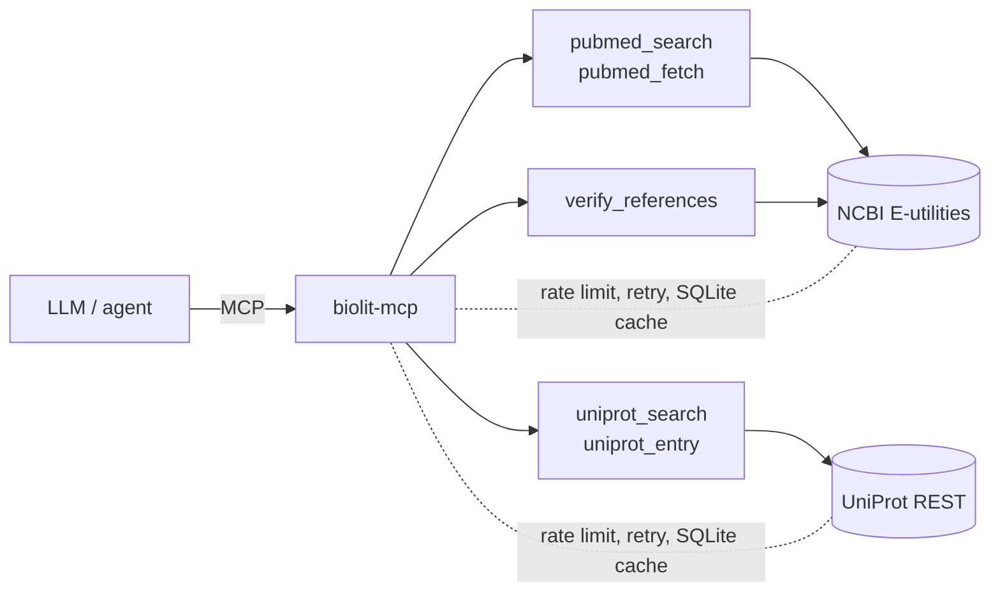

# biolit-mcp

**An MCP server that keeps LLMs honest about biomedical literature and proteins.**

Ask a language model for "three papers on base editing" and it often gives you PMIDs that do
not exist, or real PMIDs attached to the wrong titles. Ask it for the length of a protein it has
rarely seen and it will guess. `biolit-mcp` gives any MCP client (Claude Desktop, Claude Code,
Cursor, your own agent) five tools that look the answers up in PubMed and UniProt, plus a
deterministic citation checker. It also ships with an eval suite that measures how much the
tools actually reduce hallucination.



## Tools

| Tool | What it does |
|---|---|
| `pubmed_search` | PubMed search with year filters and sort. Returns PMID, title, journal, year, DOI, and PubMed's own query translation. |
| `pubmed_fetch` | Full records for up to 20 PMIDs: abstract (structured sections kept), authors, MeSH terms, DOI. Long abstracts are cut and flagged. |
| `uniprot_search` | UniProtKB search by gene or protein name, filtered by organism and Swiss-Prot status. |
| `uniprot_entry` | One entry: names, genes, organism, length, mass, function, subcellular location, GO terms; sequence on request. |
| `verify_references` | Checks a list of citations (PMID, DOI or title). Each gets a status: `verified`, `found_by_title`, `title_mismatch`, `not_found` or `unverifiable`. No model is involved in this check. |

The server also sends instructions to the client telling the model to verify every citation
before showing it and to read protein facts from `uniprot_entry` instead of memory.

## Quick start

```bash
pip install git+https://github.com/pzx1253342437-dot/biolit-mcp
```

Claude Desktop (`claude_desktop_config.json`):

```json
{
  "mcpServers": {
    "biolit": {
      "command": "biolit-mcp",
      "env": { "NCBI_API_KEY": "optional", "NCBI_EMAIL": "you@example.org" }
    }
  }
}
```

Claude Code:

```bash
claude mcp add biolit -- biolit-mcp
```

Run `biolit-mcp --http` to serve streamable HTTP instead of stdio.

| Variable | Default | Purpose |
|---|---|---|
| `NCBI_API_KEY` | none | Raises the NCBI limit from 3 to 10 requests/s |
| `NCBI_EMAIL` | none | Sent to NCBI as contact info, as their usage policy asks |
| `BIOLIT_CACHE` | `1` | Set to `0` to disable the on-disk cache |
| `BIOLIT_CACHE_DIR` | `~/.cache/biolit-mcp` | Cache location |

## Evaluation

`evals/` compares the same model with and without the tools on two task sets:

* **Citations** (20 topics): "List 3 PubMed papers about X, with PMID and title." Every claimed
  citation is checked against PubMed. Metrics: share of valid citations, nonexistent PMIDs, and
  PMIDs that point to a different paper.
* **Proteins** (10 well-known accessions + N random Swiss-Prot entries from less-studied
  organisms): "Give gene name, organism and sequence length for accession X." The gold answer
  is fetched live from UniProt at eval time, so the dataset never goes stale.

Token use, tool calls and latency are recorded per task, so the accuracy gain can be weighed
against cost.

```bash
pip install -e ".[eval]"
export ANTHROPIC_API_KEY=...
python -m evals.run --model claude-sonnet-5-5 --obscure 10
```

Each run writes the raw transcript scores to `evals/results/*.json` and a summary table to
`evals/results/*.md`.

### Results

_Not run yet. The table below is filled in from `evals/results/` after the first run._

| condition | citations valid | nonexistent PMIDs | PMID points to other paper | length exact (famous) | length exact (obscure) | gene correct | tokens / task | latency / task |
|---|---|---|---|---|---|---|---|---|
| baseline | | | | | | | | |
| tools | | | | | | | | |

## Engineering notes

* **Rate limiting** follows NCBI policy (3 req/s, or 10 with an API key) using an async limiter.
* **Retries** use exponential backoff with jitter on 429/5xx and transport errors, and honour
  `Retry-After`. 400/404 are not retried.
* **Caching**: a SQLite TTL cache (1 day for searches, 7 days for records). API keys are
  excluded from cache keys.
* **Errors the model can act on**: bad input and upstream outages come back as MCP tool errors
  with a short instruction ("use uniprot_search to find one"), so the agent can recover.
* **Context budget**: abstracts and function text are truncated with an explicit flag;
  sequences are only returned on request.

See [DESIGN.md](DESIGN.md) for the reasoning behind these choices and the known limits.

## Development

```bash
pip install -e ".[dev]"
pytest                   # offline: HTTP is mocked with recorded-format fixtures
BIOLIT_LIVE=1 pytest     # also hit the real NCBI and UniProt APIs
ruff check . && ruff format --check .
```

The offline suite covers parsing, retries, rate limiting, caching, every verification status,
the MCP tool layer, a real stdio session, and the eval harness (with a scripted model).

## Limitations

* The citation check confirms that a paper exists and that the title matches. It does not judge
  whether the paper supports the claim it is cited for.
* Title matching uses a fuzzy threshold (85/100). Very short titles or heavy rewording can be
  misjudged.
* Only PubMed and UniProtKB are covered. Preprints that are not in PubMed will show as `not_found`.

## License

MIT
